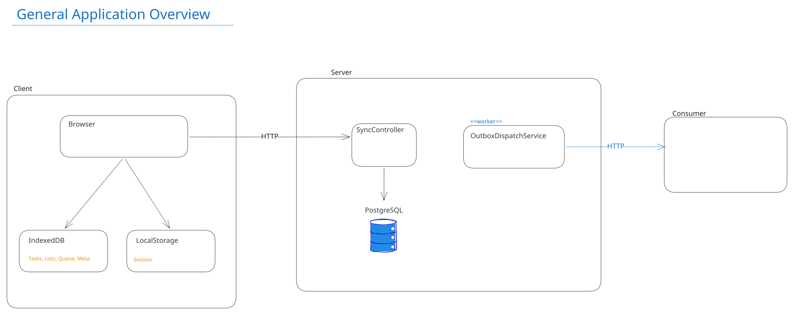
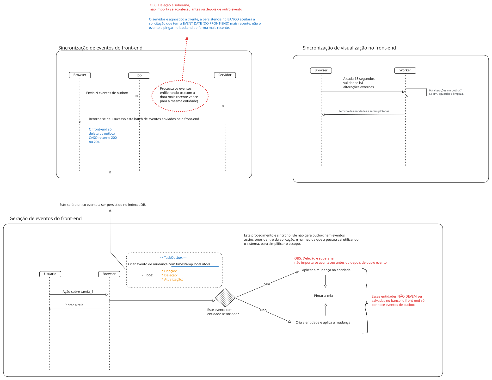
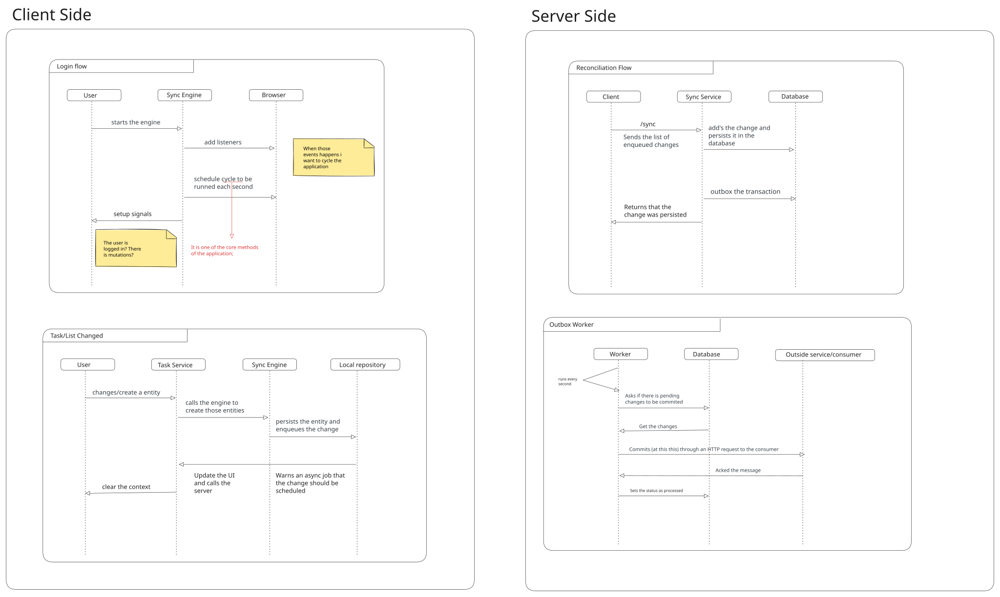
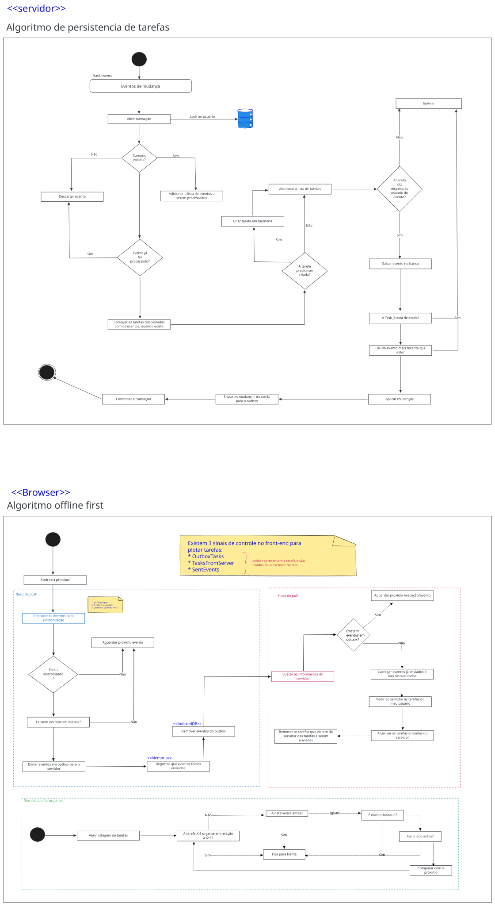

# Todo List offline-first

Lista de tarefas que funciona sem internet no celular e no desktop, sincroniza sozinha quando a conexão volta e envia as mudanças para um sistema externo simulado.

- **Frontend:** Angular 22 (PWA, signals, IndexedDB via Dexie), em `frontend/todo-web`.
- **Backend:** ASP.NET Core / .NET 10 com PostgreSQL 16, em `backend/Todo.Api`.
- **Consumidor externo simulado:** ASP.NET Core, em `backend/Consumer.Api`.
- **Diagramas:** na seção abaixo e em [`docs/diagramas`](docs/diagramas).

---

## Diagramas

Os desenhos foram feitos no Excalidraw. O arquivo `.excalidraw` de cada um está ao lado do `.svg` e abre em [excalidraw.com](https://excalidraw.com).

### Visão geral da solução



### Arquitetura offline-first: geração e sincronização de eventos



### Fluxo da aplicação: cliente e servidor



### Algoritmos: persistência no servidor e offline-first no navegador



### Diagramas de sequência detalhados (Mermaid)

- [Visão geral](docs/diagramas/visao-geral.md).
- [Sincronização offline](docs/diagramas/sincronizacao-offline.md): da gravação no aparelho até a reconciliação no servidor.
- [Integração externa](docs/diagramas/integracao-externa.md): do servidor até o consumidor.

---

## 1. Como executar

### Pré-requisitos

- Docker com Docker Compose.
- Node.js 22 ou mais novo, para o frontend.
- .NET 10 SDK, só para rodar os testes do backend.

### Passo a passo

1. Suba o banco, a API e o consumidor:

   ```bash
   docker compose up -d --build
   ```

   - API: `http://localhost:8080`
   - Consumidor externo: `http://localhost:8081`
   - PostgreSQL: `localhost:5432` (usuário, senha e banco: `todo`)

   O esquema do banco é criado automaticamente na primeira subida da API.

2. Suba o frontend:

   ```bash
   cd frontend/todo-web
   npm install
   npx ng serve
   ```

3. Abra `http://localhost:4200` e entre com um dos usuários de teste.

### Usuários de teste

| Usuário | Senha |
|---|---|
| alice | alice |
| bob | bob |

### O que dá para ver funcionando

- **Offline:** no DevTools do navegador, aba Network, escolha "Offline". Crie, edite, conclua e remova tarefas; o cabeçalho mostra "Offline · N pendente(s)". Volte para "No throttling": as mudanças sobem na hora e o indicador passa para "Sincronizado".
- **Regra do urgente:** escreva "urgente", em qualquer combinação de maiúsculas e minúsculas, no título ou na descrição. A tarefa sobe para o topo na hora, inclusive offline.
- **Consumidor externo:** `http://localhost:8081/events` lista as mudanças que ele recebeu. Os logs aparecem com `docker compose logs -f consumer`.
- **Falha do consumidor:**
  1. pare o consumidor com `docker compose stop consumer`;
  2. altere uma tarefa;
  3. volte com `docker compose start consumer`.

  A mensagem é reentregue sozinha. Para falhas aleatórias, suba o consumidor com `Consumer__FailureRate=0.5` (50% das chamadas respondem 503).
- **Conflito por horário:** o relógio de uma aba pode ser atrasado pelo console do navegador, para simular um celular com a hora errada:

  ```js
  const offsetMs = -10 * 60 * 1000;
  const RealDate = Date;
  globalThis.Date = class extends RealDate {
    constructor(...args) { super(...(args.length ? args : [RealDate.now() + offsetMs])); }
    static now() { return RealDate.now() + offsetMs; }
  };
  ```

### Testes

```bash
# Frontend: regra do urgente, ordenação e aplicação dos eventos sobre a lista
cd frontend/todo-web && npx ng test --watch=false

# Backend: chama POST /task-events de verdade contra o Postgres (banco separado todo_tests)
docker compose up -d postgres
dotnet test backend
```

---

## 2. Decisões técnicas e trade-offs

### Stack e banco de dados

- **Angular com signals:** o Angular é o desejável no enunciado. Signals bastam para o estado desta aplicação, uma lista e alguns filtros; NgRx traria muita estrutura para pouco ganho.
- **IndexedDB via Dexie:** é o armazenamento do navegador que aguenta volume e funciona offline. O Dexie só simplifica a API e avisa a tela quando os dados mudam (`liveQuery`). A lógica de sincronização é toda nossa.
- **PWA (service worker do Angular):** guarda o HTML e o JavaScript para o app abrir sem internet. Só é ativado no build de produção.
- **.NET 10 com minimal APIs e EF Core:** é o obrigatório no enunciado. As minimal APIs deixam os endpoints curtos, e o EF Core cuida do acesso ao banco.
- **PostgreSQL:** é relacional, transacional e tem `FOR UPDATE SKIP LOCKED`, que o outbox usa. Um único servidor atende a carga esperada.
- **Autenticação mockada com JWT:** dois usuários fixos no código, como o enunciado permite. O token JWT deixa o resto da API igual ao que seria com autenticação de verdade.

### Mecanismo de sincronização

O aparelho nunca grava tarefas, só eventos.

1. Toda ação do usuário (criar, editar, concluir, reabrir, remover) vira um **evento** gravado no **outbox** do IndexedDB. O evento leva a tarefa inteira e a hora do aparelho em UTC (`occurredAt`). O outbox é a única coisa salva no aparelho.
2. **A tela** é a lista vinda do servidor, guardada só em memória, com os eventos do outbox aplicados por cima: se a tarefa existe, aplica a mudança; se não existe, cria. Por isso tudo aparece na hora, inclusive offline.
3. **Job 1 (`PublishOutboxJob`):** roda no login, a cada 5 s e também assim que a conexão volta. Envia o outbox inteiro em `POST /task-events`. Um evento só sai do outbox depois que o servidor responde 2xx; se falhar, fica para a próxima rodada.
4. **Job 2 (`PullServerTasksJob`):** roda no login, a cada 15 s e quando a conexão volta. Busca o estado final das tarefas em `GET /tasks`, paginado, e troca a lista em memória. Só roda com o outbox vazio, para o servidor receber as mudanças antes de a gente ler o estado dele.
5. Os eventos já enviados continuam aplicados na tela até o próximo pull, para a tarefa não sumir entre o envio e a busca.

O servidor é a fonte da verdade. O modelo é de **consistência eventual**: cada aparelho mostra a própria visão na hora e converge para a do servidor no pull seguinte.

### Conflitos: a mesma tarefa alterada em mais de um lugar

A regra fica no `TaskService.Decide` (`backend/Todo.Api/Application/TaskService.cs`):

1. **A remoção sempre vence.** Uma tarefa removida nunca volta, mesmo que chegue depois uma edição feita mais tarde em outro aparelho. A tarefa fica marcada como removida no banco, para uma criação ou edição atrasada não ressuscitá-la.
2. **Entre edições, vence a mais recente pelo relógio do aparelho** (`occurredAt`). A tarefa guarda a hora do último evento aplicado (`LastEventAt`). Um evento mais antigo que chega depois, mesmo em outra requisição, é ignorado.

Outras decisões que sustentam a regra:

- **Histórico completo:** todos os eventos ficam gravados em ordem em `task_events`, inclusive os que perderam.
- **Reenvio seguro:** o `eventId` é único, então reenviar o mesmo lote não muda nada.
- **Uma requisição por usuário por vez:** uma linha de lock por usuário (`user_sync_locks`, travada com `SELECT ... FOR UPDATE`) impede que duas requisições do mesmo usuário leiam e gravem a mesma tarefa ao mesmo tempo. Usuários diferentes não se bloqueiam.

**Trade-off assumido:** o relógio do aparelho decide o conflito. É simples e respeita "o que o usuário fez por último", mas um celular com a hora errada pode ganhar ou perder indevidamente. A alternativa seria um vetor de versões ou um merge por campo, bem mais complexos para um app de tarefas pessoal.

### Integração externa e garantias de entrega

A técnica é o **outbox pattern** no servidor com HTTP POST para o consumidor.

- **Só sai o que o servidor reconciliou.** O `POST /task-events` grava, na mesma transação, os eventos, o estado final das tarefas e uma mensagem no outbox para cada tarefa que mudou de fato. Nada sai direto do aparelho, e uma mudança que perdeu o conflito não gera mensagem.
- **O `DeliverOutboxJob` roda a cada 1 s** dentro da API. Ele pega até 50 mensagens pendentes com `FOR UPDATE SKIP LOCKED`, para que várias instâncias da API não enviem a mesma linha, e faz o `POST /events` no consumidor com o estado final da tarefa.
- **At-least-once:** a mensagem só é marcada como entregue (`DeliveredAt`) depois de um 2xx. Se a API cair no meio, a mensagem é reenviada e pode chegar duplicada, mas nunca se perde.
- **Retry com espera crescente:** até 8 tentativas, esperando 5 s, 10 s, 20 s até 320 s (uns 10 minutos no total). Depois disso a mensagem recebe `GaveUpAt`: para de ser enviada, mas continua no banco com o último erro, para investigar e reprocessar (basta zerar o `GaveUpAt`).
- **Idempotência e ordem no consumidor:** ele ignora `eventId` repetido, mensagens mais antigas que a última aplicada para a tarefa, e qualquer coisa depois do delete. Como o retry pode entregar fora de ordem, a ordem é garantida por tarefa no consumidor.
- **O 2xx funciona como ack.** O contrato é que o consumidor só responde 2xx depois de gravar a mensagem.

Por que não RabbitMQ ou Kafka: para 1000 usuários e um consumidor, o Postgres já dá a garantia transacional (tarefa e mensagem juntas) sem mais uma peça para operar. Com muitos consumidores ou alto volume, o próximo passo seria publicar o outbox num broker.

### Ordenação das tarefas urgentes

Uma tarefa é urgente quando a palavra "urgente" aparece no título ou na descrição, como palavra inteira e sem diferenciar maiúsculas e minúsculas (expressão regular `\burgente\b` com a opção `i`). O cálculo é feito no frontend a cada renderização, sem depender do servidor, então vale offline e na hora.

A ordem padrão, usada entre as urgentes e entre as demais, é:

1. **Vencimento mais próximo primeiro**, porque o que vence antes precisa ser feito antes. Sem data vai para o fim.
2. **Prioridade alta antes de média e baixa**, para desempatar o que vence no mesmo dia.
3. **Mais antiga primeiro**, para a ordem ficar estável e não "pular" entre renderizações.

### Dimensionamento para 1000 usuários simultâneos

Uma instância da API e um PostgreSQL bastam.

- **Pull:** cada cliente busca a lista a cada 15 s. São cerca de 67 requisições por segundo de leitura, cada uma uma consulta indexada por usuário que devolve poucas centenas de linhas.
- **Envio:** só acontece quando há eventos pendentes, então o volume de escrita acompanha o uso real, que é bem menor que o de leitura.
- **Outbox:** um job com lotes de 50 por segundo cobre folgado as mudanças de 1000 pessoas editando tarefas.
- **Lock por usuário:** não cria disputa entre usuários diferentes.
- **Escala depois:** se precisar, a API é stateless, então dá para subir mais instâncias atrás de um balanceador, e o `SKIP LOCKED` já permite vários entregadores de outbox.

O que não foi feito de propósito, por não ser necessário nessa escala: cache distribuído, fila externa, microsserviços, banco replicado.

---

## 3. Premissas

- **Agrupamento por categoria:** é um campo de texto livre na tarefa. Os filtros listam as categorias em uso.
- **Hora do aparelho:** o relógio do aparelho, convertido para UTC, é confiável o bastante para decidir conflitos. É um risco assumido, explicado acima.
- **Remoção soberana:** remover vale mais que qualquer edição, mesmo uma feita depois em outro aparelho.
- **"Urgente" como palavra inteira:** "urgentes" ou "urgentemente" não contam.
- **Usuários fixos:** a autenticação é mockada, com alice e bob, e o token dura 8 h. Com a sessão expirada, o app continua abrindo e gravando no aparelho, e sincroniza depois do próximo login.
- **Consumidor simulado:** é um único consumidor, que só registra o que recebeu, em memória.
- **Sem migrations:** o esquema do banco é criado automaticamente na primeira subida, com `EnsureCreated`.

---

## 4. Limitações e próximos passos

- **Reabrir o app sem internet mostra só o que está no outbox.** As tarefas já sincronizadas ficam só em memória e voltam no primeiro pull com conexão. Para resolver, eu guardaria no IndexedDB uma cópia do último listão vindo do servidor, só para leitura, e usaria essa cópia como base da tela até o pull seguinte.
- **No `ng serve` o app não abre offline.** O service worker só é ativado no build de produção. Na demonstração, o offline é mostrado com a página já aberta, pelo DevTools. Para abrir offline de verdade, eu serviria o build de produção num container do compose (nginx).
- **Várias abas do mesmo usuário:** o job de uma aba pode enviar e limpar o outbox compartilhado, e a outra aba fica sem a tarefa na tela até o próprio pull, por no máximo 15 s. Resolveria com `BroadcastChannel` para avisar as outras abas, ou com Web Locks para só uma aba enviar.
- **Relógio do aparelho decide conflitos:** dá para reduzir o risco corrigindo a hora pelo servidor (o cliente mede a diferença no login) ou fazendo merge por campo.
- **Pull da lista inteira a cada 15 s:** é simples e suficiente para a escala pedida. Com listas grandes, eu trocaria por pull incremental ("o que mudou desde o cursor X") ou por ETag com resposta 304.
- **Um consumidor só:** para vários, bastaria uma lista de URLs e uma linha de outbox por consumidor, cada uma com o próprio retry.
- **Mensagens que desistiram (`GaveUpAt`)** são reprocessadas à mão no banco. Com mais tempo, um endpoint administrativo para listar e reenviar.
- **O consumidor simulado guarda em memória** e perde tudo ao reiniciar. Um consumidor real gravaria antes de responder 2xx.
- **Segurança de desenvolvimento:** a chave do JWT e a senha do banco estão no `appsettings.json` e no compose. Em produção iriam para um cofre de segredos.
- **Testes:**
  - os testes do backend precisam do Postgres do compose de pé;
  - faltam testes automatizados dos jobs do frontend (envio, pull e o tratamento de falhas). Eu os faria com o `TaskApi` substituído por um dublê e `fake-indexeddb`, que já está nas dependências;
  - também faltam testes de ponta a ponta no navegador. Eu os faria com Playwright, simulando offline e online.

---

## Uso de inteligência artificial

O desenvolvimento foi feito com um assistente de código com IA (Cursor). Eu defini a arquitetura e as regras de negócio:
- outbox de eventos no aparelho;
- dois jobs separados;
- servidor como fonte da verdade;
- remoção soberana e o evento mais recente vencendo;
- outbox no servidor.

Também revisei e pedi refatorações de nomes, camadas e legibilidade ao longo do caminho. O assistente escreveu boa parte do código, dos testes, dos diagramas e deste README a partir dessas decisões e me ajudou a encontrar bugs testando a aplicação no navegador. Por exemplo, foi assim que apareceu o caso da tarefa que sumia da tela entre o envio e o pull.
