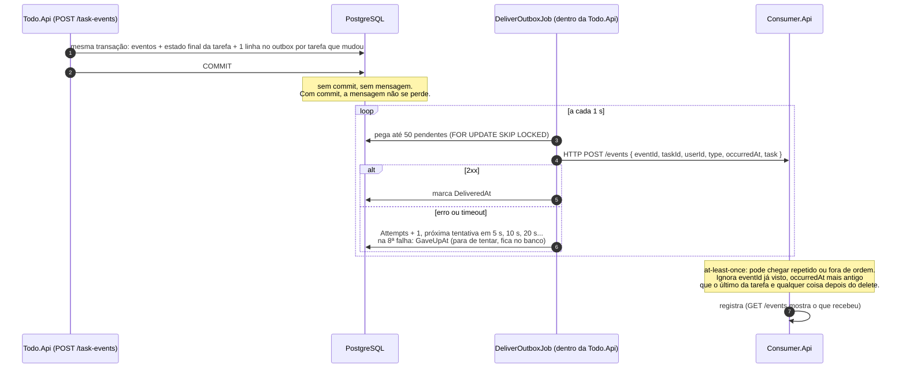

# Fluxo da integração externa

Do servidor até o consumidor. Nada sai direto do aparelho: só sai o estado final, depois que o servidor aplicou os eventos.

## Garantias

| Garantia | Como |
|---|---|
| Só propaga o que o servidor reconciliou | o outbox é escrito na mesma transação da tarefa, com o estado final |
| Não perde mensagem se a API cair | a linha pendente está no Postgres; o job continua ao subir |
| At-least-once | só marca `DeliveredAt` depois do 2xx |
| Idempotência no consumidor | `eventId` único por mensagem |
| Ordem por tarefa | o consumidor descarta `occurredAt` mais antigo e tudo depois do delete |
| Consumidor fora do ar | até 8 tentativas em ~10 min (5 s, 10 s... 320 s); depois marca `GaveUpAt` e a linha fica no banco com o último erro |
| Várias instâncias da API | `SKIP LOCKED`: cada instância pega linhas diferentes |
