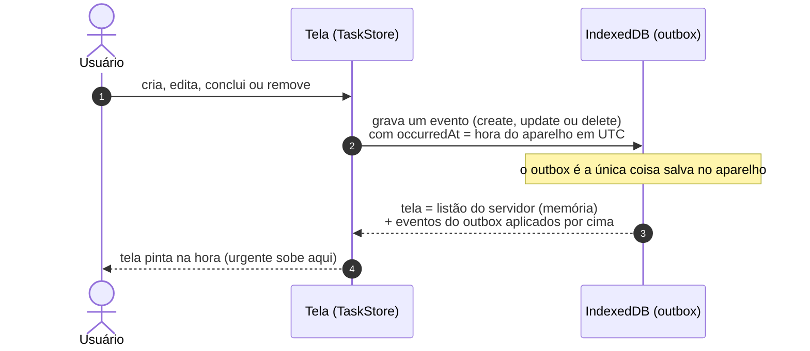
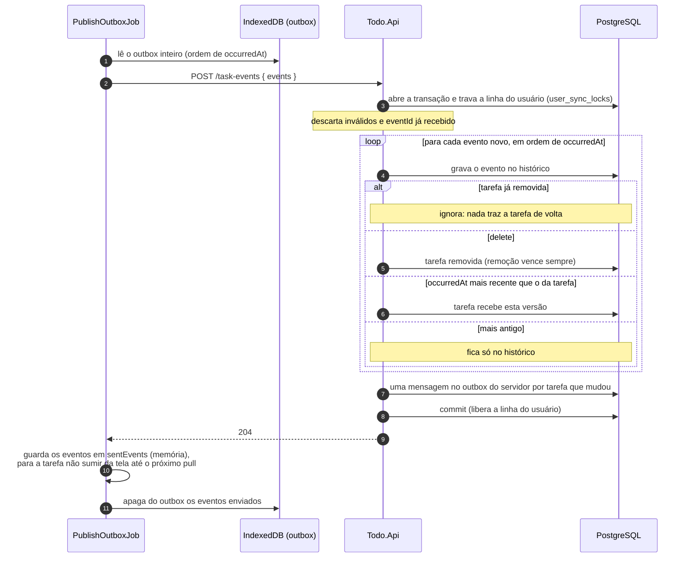
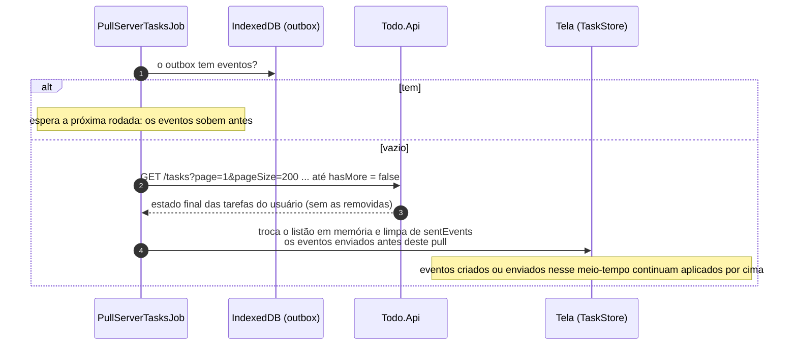

# Fluxo da sincronização offline

Da gravação local no dispositivo até a reconciliação no servidor.

## Geração de eventos no aparelho

Ao aplicar um evento, a tela faz assim: se a tarefa existe na lista, aplica a mudança; se não existe, cria. Entre eventos da mesma tarefa, vale o `occurredAt` mais recente. A remoção vence sempre.

## Envio do outbox: PublishOutboxJob, no login, a cada 5 s e quando a conexão volta

## Busca do estado final: PullServerTasksJob, no login, a cada 15 s e quando a conexão volta

## Regras

- A tela nunca chama a API. Ela só grava eventos no outbox.
- O servidor só aceita eventos e decide o estado final sozinho: vale o `occurredAt` mais recente, e a remoção vence sempre. A hora do servidor não entra na decisão.
- Reenviar o mesmo evento não duplica nada, porque o servidor ignora `eventId` repetido.
- Um evento só sai do outbox quando o servidor responde 2xx.
- As tarefas vindas do servidor ficam só em memória, não no IndexedDB.

## Riscos e limitações assumidos

- O relógio do aparelho decide o conflito. Um celular com a hora errada pode ganhar ou perder indevidamente.
- Se o app for reaberto sem internet, a tela mostra só o que está no outbox. As tarefas já sincronizadas voltam no primeiro pull com conexão.
