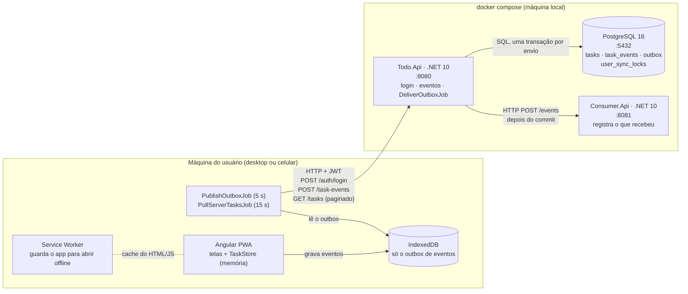

# Visão geral da solução

Quais são os componentes, onde cada um roda e como se comunicam.

| Componente | Roda onde | Faz o quê |
|---|---|---|
| Angular PWA | navegador do usuário | telas, regra do urgente; toda ação vira um evento no outbox |
| IndexedDB | navegador do usuário | só o outbox: eventos que o servidor ainda não recebeu |
| Service Worker | navegador do usuário | deixa o app abrir sem internet |
| Todo.Api | container `api` | login mockado (JWT), aceita os eventos, decide o estado final, lista as tarefas, entrega eventos aos consumidores |
| PostgreSQL | container `postgres` | fonte da verdade: tarefas e outbox de eventos |
| Consumer.Api | container `consumer` | consumidor externo simulado, só recebe e mostra |
